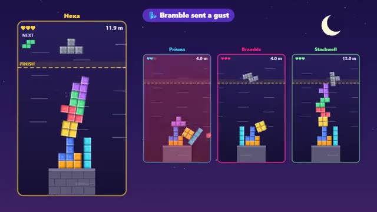

# Tower Stack

Stack wobbly blocks. First tower over the line wins. A multiplayer starter game from [Multiplayer Agent](https://multiplayeragent.com): 2D, versus, 2–4 players, with bots that fill empty seats.

## How it plays

Falling blocks with real physics: they tip, slide and topple. Build past the gold line and hold it there for two seconds. Every block that falls off costs a life, and spells let you glue your tower or blow wind at your rivals.

**Controls:** Arrow keys, Space to drop, E for a spell; or drag to move, tap to turn, flick down to drop.

## Make it yours in the Game Builder

Open the [Game Builder](https://multiplayeragent.com), choose **Start from a starter game** and pick Tower Stack. It opens as version 1 in your studio, ready to play and publish. Then ask for changes, for example:

- Add a spell that shrinks a rival's next piece
- Make the base narrower and the line higher
- Add a survival mode where the line keeps rising

## Run it yourself

1. Get a free publishable key (`pk_…`) at [multiplayeragent.com](https://multiplayeragent.com).
2. In `index.html`, put it in place of `pk_REPLACE_ME` in the `MP_CONNECT` block.
3. Open `index.html` in a browser. No build step and no server needed.

Without a key it still runs, offline against bots.

## How it is built

- One `index.html`. The comment at the top of the script maps the code and explains the multiplayer.
- A small rigid-body solver for boxes (in the style of Box2D Lite) runs each tower in the browser that owns it.
- **Live sync:** You watch every rival's tower wobble as they build it.
- **Host-run rounds:** The host's browser runs the match: who is out, the winner and the restart. If it leaves, the next player takes over.
- **Bots:** Bots fill empty seats, read their tower's skyline and stack sensibly.
- **Leaderboard:** Each player's fastest time to the finish line.
- `?attract` runs it offline with bots only. The preview video is recorded from it.

## License

MIT.
